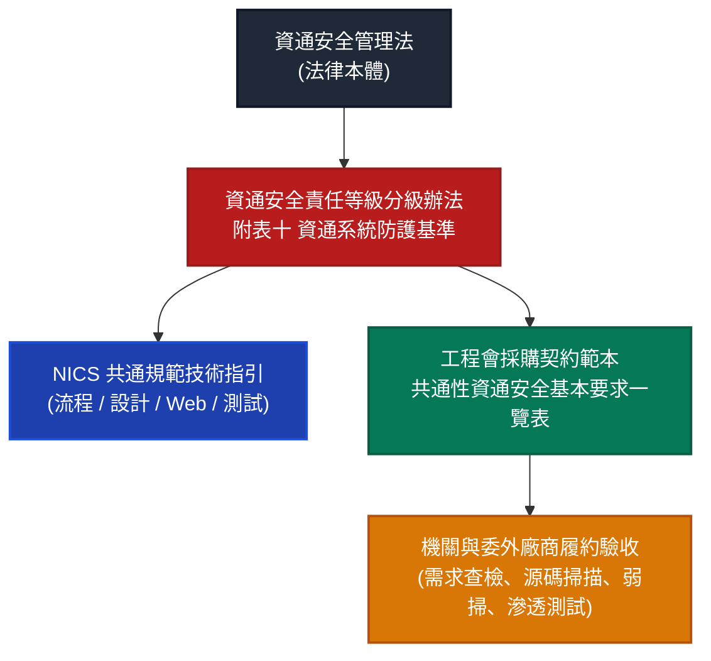
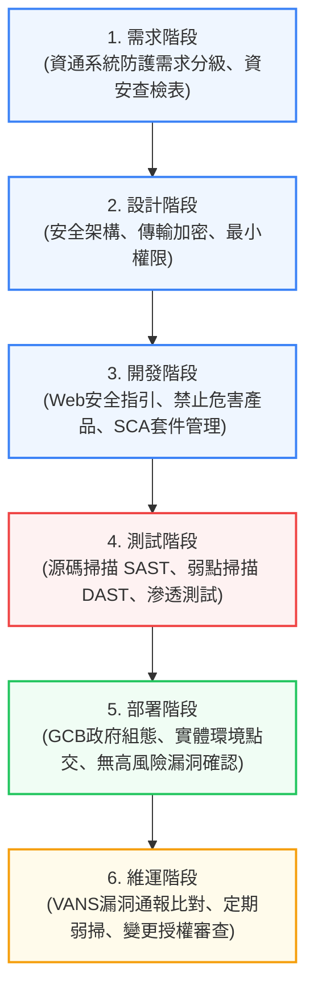

# 臺灣政府資訊系統安全開發規範與 SSDLC 官方範本深度研究報告

**研究執行日期**：2026 年 10 月 10 日  
**研究團隊**：資安治理與系統工程研究小組（人機協作）  
**研究範圍**：數位發展部（MODA）、國家資通安全研究院（NICS）、國家科學及技術委員會（NSTC）、行政院公共工程委員會（PCC）及政府採購法規公開資料庫  
**查證基準**：以執行當日可查證之最新有效資料為準，保留歷史脈絡與版本演進，恪遵繁體中文（台灣用語）及行動端閱讀體驗。

---

## 報告一：研究總結（Executive Summary）

### 1. 臺灣目前是否存在官方 SSDLC 規範？
**答案：存在，且架構為「法規強制控制底線 ＋ 行政指導技術指引 ＋ 採購契約強制轉化」的三層體系。**
臺灣政府並非以單一一部名為《政府安全軟體開發生命週期法》的法典推動，而是以：
1. **法律底線**：《資通安全管理法》第 10 條及其授權子法《資通安全責任等級分級辦法》**「附表十 資通系統防護基準」**（最新修正為 115 年 1 月 7 日），法律強制要求各機關自行或委外開發之資通系統，必須依防護等級（普、中、高）落實全生命週期之安全控制措施。
2. **作業技術指引**：國家資通安全研究院（NICS，前行政院國家資通安全會報技術服務中心 NCCST）發布的**「共通規範系列」**（包含《安全軟體發展流程指引》、《安全軟體設計參考指引》、《Web應用程式安全參考指引》、《安全軟體測試參考指引》）。
3. **軟體供應鏈新制**：資安署與資安院推動之「數位韌性教材專區」SBOM（軟體物料清單）與 CI/CD 自動化安全檢測規範。

### 2. 哪個機構提供的文件最完整？
- **最高法定權威與強制基準主管機關**：**數位發展部（MODA）/ 資通安全署**。負責制定《資通系統防護基準》及《資通安全維護計畫範本》。
- **技術指引與實作規格最完整機構**：**國家資通安全研究院（NICS）**（含前身技服中心）。提供涵蓋需求、設計、Web 開發、測試至紅隊演練的具體指引，以及最新版《Web應用程式安全參考指引 v3.2》。
- **採購合約與委外履約強制轉化機關**：**行政院公共工程委員會（PCC）** 與數位發展部會銜發布之《資訊服務採購契約範本》及其附表。

### 3. 哪些規範具有法律或行政拘束力？
| 規範名稱 | 法律/行政性質 | 對公務機關拘束力 | 對委外廠商拘束力 |
| :--- | :--- | :--- | :--- |
| **《資通安全管理法》第 10 條及施行細則** | 法律 / 法規命令 | **絕對強制（法定法遵義務）** | **透過委外契約轉化為履約義務** |
| **《資通安全責任等級分級辦法》附表十 資通系統防護基準** | 法規命令（法規授權強制條款） | **絕對強制（依法分級普/中/高落實）** | **機關驗收必須依此查核** |
| **《各類資訊採購共通性資通安全基本要求參考一覽表》** | 行政院採購契約標準要件 | **高度拘束（採購時原則納入）** | **契約簽訂後具民事履約法律強制力** |
| **NICS《安全軟體發展流程/設計/測試指引》** | 行政指導 / 技術參考指引 | 建議遵循（實質為防護基準技術補充） | 視 RFP 是否載明要求為準 |

### 4. 是否有官方可下載的 SSDLC 範本？
**答案：有，但型態多為「檢核表（Checklist）」與「RFP 契約條款範本」，而非單一填空式 Word 筆記。**
- **A 類（獨立可編輯下載範本）**：包含《各類資訊採購共通性資通安全基本要求參考一覽表》（工程會/數位部 ODF/Word）、《資通系統資安需求項目查檢表》（資安署 ODF）、《資通系統防護基準檢核表》（數位部 ODS）、《零信任架構功能符合性自評表》（NICS ODF）。
- **B 類（規範內含表單/檢核表）**：包含《安全軟體發展流程指引》附錄檢核項目、《Web應用程式安全參考指引 v3.2》控制檢核清單、《資通安全實地稽核項目檢核表》。
- **滲透測試/源碼檢測「填空式報告」現況（C 類）**：官方**並未提供單一填空式滲透測試報告 Word 檔**，而是透過防護基準明定報告必備欄位（CVSS、威脅等級、PoC、修補建議），由廠商依標準格式產出後由機關驗收。

### 5. 哪些規範最適合政府資訊系統開發及委外管理？
最務實的黃金組合架構：
1. **招標與委外合約層**：採用工程會最新**《資訊服務採購契約範本》**＋ 附件**《各類資訊（服務）採購之共通性資通安全基本要求參考一覽表》**。
2. **規格制定與需求層**：套用資安署**《資通系統資安需求項目查檢表》** ＋ **《資通系統防護基準》（附表十）**。
3. **廠商開發與交付層**：要求廠商遵循 NICS **《Web應用程式安全參考指引 v3.2》**，並於交付驗收時提交無中高風險弱點之原始碼掃描（SAST）、弱點掃描（DAST）及滲透測試報告。

---

## 報告二：官方文件總整理表



| 文件名稱 | 發布機關 | 文件類型 | 最新版本 / 發布日期 | 適用對象 | SSDLC 階段 | 是否有範本 (分類) | 官方連結 / 取得管道 |
| :--- | :--- | :--- | :--- | :--- | :--- | :--- | :--- |
| **資通系統防護基準 (附表十)** | 數位發展部 | 法規命令 (分級辦法附表) | 115.01.07 修正發布 | 全國公務機關及特定非公務機關 | 全階段 (規劃至維運) | **有 (A類/ODS, PDF)** | [全國法規資料庫 (A0030294)](https://law.moj.gov.tw/LawClass/LawAll.aspx?pcode=A0030294) |
| **各類資訊採購共通性資通安全基本要求參考一覽表** | 行政院公共工程委員會 / 數位部 | 採購契約範本附件 | 113.12.26 修正 | 政府委外資訊服務得標廠商 | 需求、採購、驗收、維運 | **有 (A類/ODF, Word)** | [公共工程委員會政府採購專區](https://pcc.gov.tw) |
| **資通系統資安需求項目查檢表** | 數位發展部資通安全署 | 參考範本與檢核表 | 隨防護基準修訂 (V2.0) | 機關資訊人員、委外專案經理 | 需求分析、規格訂定 | **有 (A類/ODF)** | [數位發展部資通安全署 (ACS)](https://moda.gov.tw/ACS/) |
| **Web 應用程式安全參考指引** | 國家資通安全研究院 (NICS) | 技術共通規範 | v3.2 (114.12.31) | 軟體開發工程師、架構師 | 設計、開發、測試 | **有 (B類/內含檢核清單)** | [國家資通安全研究院共通規範專區](https://www.nics.nat.gov.tw) |
| **安全軟體發展流程指引** | 國家資通安全研究院 (技服中心) | 技術參考指引 | v1.0 (歷史有效基礎框架) | 機關資訊主管、專案經理 | 全階段 (SSDLC 流程) | **有 (B類/內含流程查驗表)** | [NICS 共通規範專區](https://www.nics.nat.gov.tw) |
| **安全軟體設計參考指引** | 國家資通安全研究院 (技服中心) | 技術參考指引 | v1.0 (歷史有效基礎框架) | 系統分析師、架構設計師 | 設計階段 (威脅建模/加密) | **有 (B類/設計考量表)** | [NICS 共通規範專區](https://www.nics.nat.gov.tw) |
| **安全軟體測試參考指引** | 國家資通安全研究院 (技服中心) | 技術參考指引 | v1.0 (歷史有效基礎框架) | 測試工程師、資安檢測廠商 | 測試驗收階段 (SAST/DAST) | **有 (B類/檢測項目對照)** | [NICS 共通規範專區](https://www.nics.nat.gov.tw) |
| **政府資訊作業委外安全參考指引** | 數位發展部 / NICS (前行政院資安處) | 作業參考指引 | 現行通用版 (v6.x-v7.x) | 機關採購承辦、受託廠商 | 委外監督、履約管理 | **有 (A類+B類/含RFP條款)** | [NICS 共通規範專區](https://www.nics.nat.gov.tw) |
| **資通安全實地稽核項目檢核表** | 數位發展部資通安全署 | 行政稽核標準表單 | 每年定期公布最新版 (ODF) | 公務機關受稽核對象 | 維運、稽核、合規性查驗 | **有 (A類/ODF)** | [資通安全署實地稽核專區](https://moda.gov.tw/ACS/) |
| **數位韌性教材-軟體供應鏈安全與SBOM** | 國家資通安全研究院 | 實務教材與自動化範本 | 113-114 年推動專題 | 開發維運人員、DevSecOps | 開發、相依套件、部署 | **有 (B類/含開源腳本與CI/CD範本)** | [NICS 數位韌性教材專區](https://material.nics.nat.gov.tw) |

---

## 報告三：SSDLC 規範對照矩陣

本矩陣依 SSDLC 六大標準階段，完整對齊臺灣官方第一手規範依據與交付證據：



### 階段 1：需求階段（Requirements）
- **官方依據**：《資通安全責任等級分級辦法》第 11 條及附表九、附表十；《資通系統委外開發 RFP 資安需求範本》。
- **應執行之控制措施**：
  1. 完成資通系統防護需求分級評估（機密性、完整性、可用性衝擊分析，評定為「普、中、高」等級）。
  2. 將法規防護基準條款轉化為招標規格或需求規格書之明確項目。
  3. 明訂委外廠商之資通安全責任與人員保密協定。
- **必要/建議之工作成果**：系統防護等級分級表、資訊安全需求規格書（或納入 RFP）。
- **對應表單或檢核表**：`資通系統資安需求項目查檢表 (ODF)`。
- **適用性及強制程度**：**法定強制義務**。

### 階段 2：設計階段（Design）
- **官方依據**：附表十「系統架構與存取控制」構面；NICS《安全軟體設計參考指引》；《零信任架構推動指引》。
- **應執行之控制措施**：
  1. 最小授權原則（PoLP）與職能分工（SoD）存取架構規劃。
  2. 敏感資料傳輸與儲存加密設計（如採用 TLS 1.3、強固雜湊演算法加鹽儲存密碼）。
  3. 身分鑑別機制（高防護系統強制規劃多因子驗證 MFA）。
- **必要/建議之工作成果**：系統架構設計規格書、網路拓撲與資料流向圖、威脅模型分析紀錄（建議）。
- **對應表單或檢核表**：系統安全架構檢核表（對照附表十系統與服務獲得構面）。
- **適用性及強制程度**：**法定強制義務**（針對防護基準明定項目）。

### 階段 3：開發階段（Development）
- **官方依據**：NICS《Web應用程式安全參考指引 v3.2》；行政院限制採購大陸廠牌資通訊產品原則。
- **應執行之控制措施**：
  1. 防範 OWASP Top 10 與 CWE 常見軟體漏洞（嚴格落實參數化查詢防範 SQL Injection、輸出編碼防範 XSS）。
  2. 禁用硬編碼（Hard-coded）機敏金鑰或預設密碼於原始碼中。
  3. 軟體供應鏈管控：第三方開源套件相依性檢查，產出 SBOM（物料清單）。
  4. 嚴格禁止使用大陸廠牌資通訊產品或具資安疑慮之套件模組。
- **必要/建議之工作成果**：安全程式碼撰寫規範遵循紀錄、SBOM 清單（Syft/Trivy 產出）、版本控制 Commit 日誌。
- **對應表單或檢核表**：《Web 應用程式安全檢核清單》（B 類附錄）。
- **適用性及強制程度**：Web 指引屬**行政指導**；大陸廠牌禁用與附表十防護要求屬**法定強制**。

### 階段 4：測試階段（Testing）
- **官方依據**：附表十「系統發展與維護」之測試要求；工程會《共通性資通安全基本要求一覽表》；NICS《安全軟體測試參考指引》。
- **應執行之控制措施**：
  1. **原始碼安全檢測（SAST，白箱）**：高、中防護系統必須執行，且不得含有「高風險（High/Critical）」漏洞。
  2. **系統弱點掃描（DAST/Infra，黑箱）**：上線前執行，中高風險弱點須於驗收前全數修補完成。
  3. **滲透測試（Penetration Testing）**：核心或核心對外服務系統，上線前強制辦理黑箱/灰箱模擬攻擊。
- **必要/建議之工作成果**：原始碼掃描報告、弱點掃描報告、滲透測試報告、弱點修補複測複驗報告。
- **對應表單或檢核表**：源碼檢測修復確認單、弱點掃描追蹤表。
- **適用性及強制程度**：**法定強制驗收條件**。

### 階段 5：部署階段（Deployment）
- **官方依據**：政府組態基準（GCB）；附表十「組態管理」與「測試與實際上線環境區隔」。
- **應執行之控制措施**：
  1. 測試環境與正式營運環境實體或邏輯獨立隔離。
  2. 作業系統、資料庫及網頁伺服器導入 GCB 政府組態基準。
  3. 停用不必要之系統埠口、服務與預設帳號密碼。
- **必要/建議之工作成果**：GCB 檢測合規報告、系統上線檢核單、組態基準備份紀錄。
- **對應表單或檢核表**：`系統更版/上線前安全檢核表`。
- **適用性及強制程度**：**法定強制義務**。

### 階段 6：維運階段（Operations & Maintenance）
- **官方依據**：《資通安全維護計畫》；VANS（資通安全弱點通報系統）介接作業要點；附表十變更管理要求。
- **應執行之控制措施**：
  1. 系統資產與套件清冊定期匯入 VANS，與國家 NVD/CVE 資料庫自動比對。
  2. 系統變更申請與授權簽核，更版時執行回滾（Rollback）機制演練。
  3. 定期備份（3-2-1 原則）與每年至少一次系統還原演練。
- **必要/建議之工作成果**：VANS 比對修補紀錄、變更申請授權單、系統還原演練紀錄。
- **對應表單或檢核表**：`系統變更申請與授權紀錄單`、`資通安全實地稽核項目檢核表`。
- **適用性及強制程度**：**法定強制義務**。

---

## 報告四：官方範本下載與套用清單

本清單聚焦於 12 項關鍵範本在臺灣政府體系中的真實取得狀態，嚴格區分 **A 類（官方直接下載公版）**、**B 類（規範內含表單）**、**C 類（僅要求規格無公版）** 及 **D 類（建議客製表單）**：

| 編號 | 需求項目名稱 | 實務官方對應文件名稱 | 分類 | 提供格式 | 可否直接使用與套用建議 | 官方取得途徑 / 下載來源 |
| :---: | :--- | :--- | :---: | :---: | :--- | :--- |
| **1** | 資訊系統安全需求規格書 | 資通系統委外開發 RFP 資安需求範本附件 | **A 類** | ODF / Word | **可直接修改使用**：將招標案所涉防護等級（普/中/高）勾選後納入招標需求書。 | [數位發展部資通安全署 (ACS)](https://moda.gov.tw/ACS/) |
| **2** | SSDLC 作業程序書 | 系統安全開發與維護管理程序 (ISMS 二階程序) | **D 類** | 參考框架 | **需機關自行制定**：官方僅提供指引框架，機關需依 ISO 27001 格式制定內控 SOP。 | 參照 NICS《安全軟體發展流程指引》轉換 |
| **3** | 系統安全設計檢核表 | 系統安全架構與防護基準對照表 | **B 類** | ODS / Excel | **建議調修使用**：直接擷取《資通系統防護基準》ODS 檔中的「系統與服務獲得」構面。 | [全國法規資料庫 (附表十)](https://law.moj.gov.tw/LawClass/LawAll.aspx?pcode=A0030294) |
| **4** | 安全程式碼撰寫規範 | Web 應用程式安全參考指引附錄規範 | **B 類** | PDF / 條文 | **可直接引用**：合約載明「委外開發團隊程式撰寫應遵循 NICS Web 應用程式安全參考指引最新版」。 | [NICS 共通規範專區](https://www.nics.nat.gov.tw) |
| **5** | 程式碼安全檢測檢核表 | 原始碼檢測報告查驗與修復確認單 | **C 類** | 規格要求 | **由廠商交付檢測報告**：官方要求產出無中高風險弱點之檢測報告，機關以驗收單覆核。 | 工程會《共通性資通安全基本要求一覽表》 |
| **6** | 弱點掃描與修補追蹤表 | 資通系統防護基準查核項目 / VANS 追蹤表 | **B 類** | Excel / ODS | **建議調修使用**：機關資安管理人員列管漏洞項目、CVSS 評分、修補責任人與複測日期。 | [資安署弱點通報作業手冊](https://moda.gov.tw/ACS/) |
| **7** | 滲透測試報告範本 | 滲透測試報告規範要件 (無單一官方 Word 範本) | **C 類** | 內容規範 | **不可套用空範本**：官方規定報告需具備涵蓋範圍、滲透方法、CVSS、危害細節與佐證截圖。 | NICS《安全軟體測試參考指引》 |
| **8** | 資訊系統安全測試計畫 | 系統上線前資安檢測計畫書規範 | **C 類** | 契約要求 | **需廠商依約研提**：由承接廠商於測試階段前提出黑白箱時程與測試範疇，機關審查。 | 工程會《資訊服務採購契約範本》 |
| **9** | 系統上線安全檢核表 | 資訊系統更版 / 上線前安全查驗單 | **B 類** | ODF / Word | **可直接修改使用**：各機關 ISMS 必備表單，確認弱掃合格、預設密碼變更、GCB 套用等。 | 數位部 ISMS 參考表單 / 地方政府公開範本 |
| **10** | 資訊系統安全驗收檢核表 | 資訊採購履約驗收資通安全查核紀錄表 | **A 類** | ODF / Word | **可直接使用**：對照工程會《共通性資通安全基本要求一覽表》各項交付物逐一打勾驗收。 | [工程會政府採購專區](https://pcc.gov.tw) |
| **11** | 委外廠商資安管理檢核表 | 委外廠商資安監督與實地訪評檢核表 | **A 類** | ODF / Word | **可直接使用**：用於資安法第 10 條要求之受託者監督、保密協議、開發環境實地稽核。 | [數位發展部資通安全署業務專區](https://moda.gov.tw/ACS/) |
| **12** | 系統變更及安全維護紀錄表 | 資訊系統變更申請與授權紀錄單 | **D 類** | 表單範本 | **機關需自行建立**：依據機關自身分層負責授權規定，建立變更原因、影響評估與回復計畫單。 | 參照 ISO 27001 A.8.32 變更管理架構 |

---

## 報告五：實務導入建議（政府機關落地實務指南）

本建議假定情境為：**臺灣公務機關資訊單位，負責自行開發或委外建置資訊系統，需建立合理、可稽核、能納入採購及驗收的 SSDLC 管理制度。**

### 1. 最值得優先採用的官方規範與選擇理由
- **最核心法規依據**：**《資通系統防護基準》（資通安全責任等級分級辦法附表十）**。
  - **選擇理由**：這是法務稽核與資安署實地稽核的唯一考核標準。若偏離此基準自行發明流程，稽核時將無法提出法定合規佐證。
- **委外契約轉化必備**：**工程會《資訊服務採購契約範本》＋《各類資訊採購共通性資通安全基本要求參考一覽表》**。
  - **選擇理由**：將抽象的技術規範「法律化、契約化」。未寫入契約的要求，廠商依法有權拒絕執行或要求辦理契約變更追加預算。
- **技術開發準繩**：**NICS《Web應用程式安全參考指引 v3.2》**。
  - **選擇理由**：具體將 OWASP Top 10 防護落實為可執行的工程規範，防範絕大多數注入與權限漏洞。

### 2. 精簡但完整的 SSDLC 作業流程
```
[需求階段] 評估防護等級(普/中/高) ──> 填寫《資安需求項目查檢表》 ──> 納入採購 RFP
    ↓
[設計階段] 檢視系統拓撲與資料流 ──> 確認 MFA/傳輸加密/職能分工 ──> 產出設計審查紀錄
    ↓
[開發階段] 依循《Web安全指引》 ──> 啟用 CI/CD ──> 產出 SBOM 與禁止大陸廠牌零組件
    ↓
[測試階段] 執行源碼掃描(SAST) ──> 弱點掃描(DAST) ──> 滲透測試(高/中防護) ──> 修補複測
    ↓
[部署階段] 套用 GCB 組態基準 ──> 測試與正式環境隔離 ──> 簽核《上線安全檢核表》
    ↓
[維運階段] 匯入 VANS 漏洞比對 ──> 變更管理簽核 ──> 執行備份還原演練 ──> 配合年度稽核
```

### 3. 上線前應完成的安全驗收項目（驗收交付物清單）
1. **原始碼安全檢測報告（白箱）**：高、中級系統必備，第三方或原廠掃描報告中，不得有中高風險弱點。
2. **弱點掃描報告（黑箱）**：系統與 Web 應用程式無「中、高風險」漏洞，且需檢附修補後複測通過紀錄。
3. **滲透測試報告**：針對核心對外系統，由具公信力資安專家出具，檢附弱點驗證細節與複測改善證明。
4. **受託者資安宣告書**：聲明未採用大陸廠牌軟硬體、開源套件無已知重大漏洞、原始碼無後門機制。
5. **備份還原測試報告**：確認災難復原機制可正常運作。

---

### 4. 最低可行 SSDLC 管理制度（MVP 分級標準）

> **[!IMPORTANT]**
> 此分類為本研究依實務推動成本與稽核效益所整理之**工程實踐建議**，各機關實際適用之控制措施仍應以其法定資通安全責任等級及系統防護等級之法律義務為準。

#### 🟢 必要級（Must-Have：法遵底線，適用所有自建與委外系統）
- 系統完成防護需求分級（普、中、高）評定。
- 委外採購完整引用工程會資安條款，並簽署保密協定（NDA）。
- 上線前強制完成「弱點掃描」，中高風險弱點全數修補完成。
- 正式伺服器主機套用 GCB 政府組態基準。
- 備有明確的上線簽核紀錄與系統變更申請單。

#### 🟣 建議級（Should-Have：推薦機關落實之標準防護架構）
- 中級以上防護系統，上線前強制執行「原始碼安全檢測（SAST）」並產出修復確認單。
- 核心對外系統上線前執行獨立第三方「滲透測試」。
- 開發流程要求廠商交付 SBOM（軟體物料清單），並透過 Trivy/Syft 檢驗套件漏洞。
- 正式營運後將資產納入 VANS（資通安全弱點通報機制）定期比對。
- 建立每年至少一次的資料備份實體驗證還原作業。

#### 🛡️ 進階級（Nice-to-Have：高防護、核心骨幹與成熟 DevSecOps 機關）
- 導入 CI/CD Pipeline 自動化安全測試（Security as Code），程式碼 Commit 即自動觸發 SAST 與 SCA 掃描。
- 全面介接數位發展部「零信任架構（ZTA）」，導入身分鑑別與設備鑑別機制。
- 定期委請外部紅隊執行攻擊演練（Red Teaming）。
- 導入 PSIRT 漏洞獵捕（Bug Bounty）或主動通報應變計畫。

---

## 報告限制與研究查證宣告
1. **法規基準時間**：本報告依截至 2026 年 10 月 10 日止最新有效之《資通安全管理法》及其子法（含 115 年 1 月 7 日修正發布之附表十）完成比對。
2. **機關資料限制**：部分機關（如國科會）之系統開發 SOP 屬於內部 ISMS 封閉文件，未對外公開公版下載，實務上係以工程會採購契約為核心履約文件。
3. **客製化建議**：政府單位導入時，應優先下載資安署 ODF 公版檢核表進行「剪裁（Tailoring）」，切勿未經剪裁直接全盤硬套，以防徒增行政作業摩擦。
